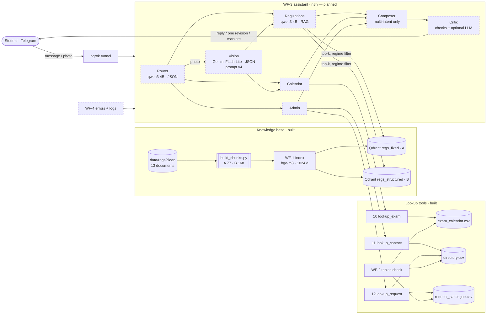

# CampusFlow AI — architecture (CF-014)

State on 26 Oct 2026. Solid boxes exist and are tested; dashed boxes are planned (Phase 4–7). The conditional Composer
and the deterministic Critic follow the latency budget proposed in ADR-010 (CPU: 30.7 tok/s prefill, 4.1 tok/s output).

| Part | Technology | Status | Evidence |
|---|---|---|---|
| Channel | Telegram bot + ngrok static domain | working (smoke test) | `workflows/00_smoke_test.json` |
| Router, specialists, Composer, Critic | n8n + Ollama qwen3 4B, prompts `prompts/P-*-001.md`, schemas `prompts/schemas/` | prompts + schemas ready; Router measured (CF-022) | `eval/agents/router_v1.md` |
| Vision | Gemini Flash-Lite, prompt v4 | measured 87/88 fields on T4 | `eval/agents/vision_v1_to_v4.md` |
| Regulations KB | 13 docs → chunks A/B → bge-m3 → Qdrant | indexed (WF-1) | `eval/retrieval/ingestion_log.md` |
| Tables | 3 CSV + tools 10–12 + WF-2 | tested (30 node tests + live run) | `eval/agents/tools_test.md` |
| Latency | CPU only | measured, budget proposed | `eval/latency/README.md`, ADR-010 |
